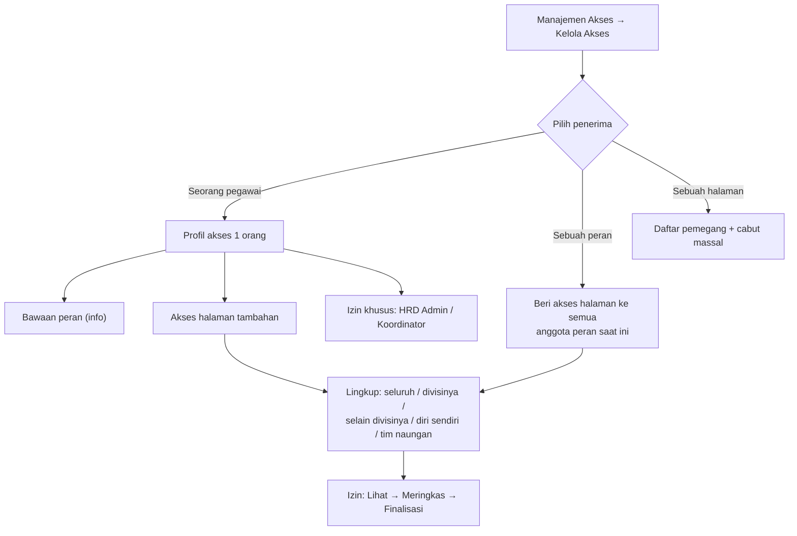
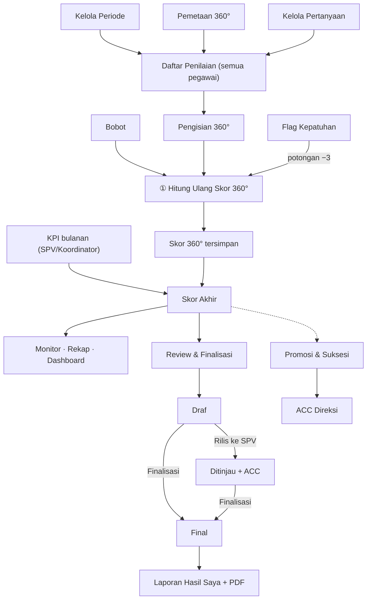
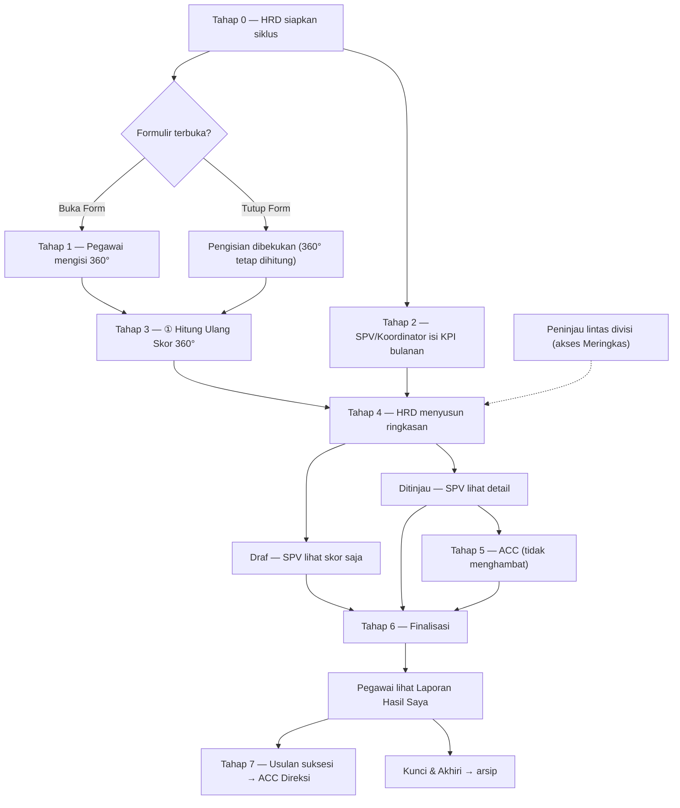
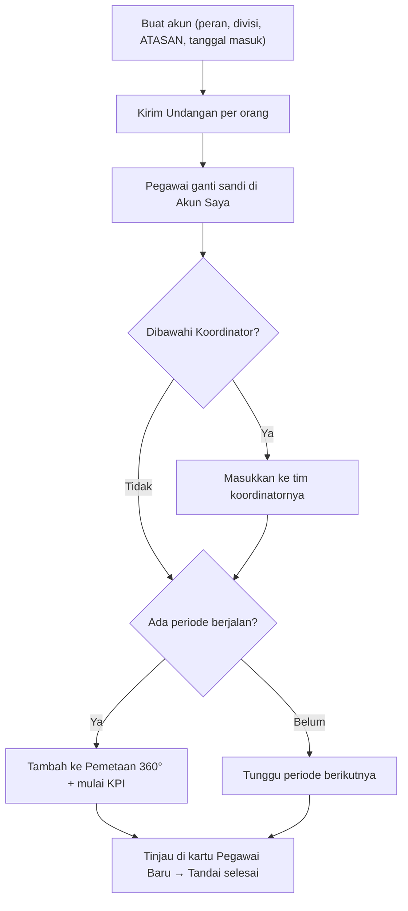
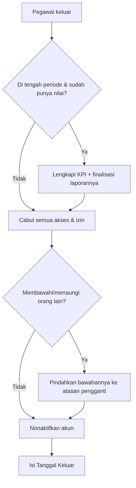

# Panduan Pengguna — Infarm 360° Portal

Panduan memakai aplikasi penilaian kinerja 360° Infarm, per peran. Nama tombol dan menu ditulis
**persis** seperti di aplikasi. Isinya mengikuti aplikasi yang sedang berjalan (production).

**Cara membaca tabel tombol:** kolom **Konfirmasi** berisi "Ya" bila muncul jendela konfirmasi di dalam
aplikasi, "Bersyarat" bila konfirmasi hanya muncul pada keadaan tertentu, dan "—" bila aksi langsung jalan.
Hampir semua aksi yang mengubah data hanya bisa dilakukan saat ada **periode aktif**.

## Daftar isi
1. [Umum — semua peran](#1-umum--semua-peran)
2. [Pegawai](#2-pegawai)
3. [Supervisor (SPV)](#3-supervisor-spv)
4. [Koordinator & akses tambahan dari HRD](#4-koordinator--akses-tambahan-dari-hrd)
5. [HRD Admin](#5-hrd-admin)
6. [Direksi](#6-direksi)
7. [Cara nilai dihitung](#7-cara-nilai-dihitung)
8. [Alur lengkap & siapa melihat apa](#8-alur-lengkap--siapa-melihat-apa)
9. [SOP HRD](#9-sop-hrd)

---

## 1. Umum — semua peran

### 1.1 Login
1. Buka aplikasi.
2. Pilih **Nama** Anda. Dropdown punya kotak pencarian: ketik sebagian nama untuk menyaring. Daftar diambil
   dari data pegawai aktif, lengkap dengan posisinya. Saat nama dipilih, **Peran** terisi otomatis. Anda juga
   bisa memilih Peran dulu untuk menyaring nama.
3. Masukkan **Sandi**, lalu klik **Masuk**.

Kolom nama selalu tampil sejak halaman dibuka. Pegawai baru otomatis muncul di daftar. Ada juga cadangan
**Masuk dengan email manual**. Ikon mata di samping kolom sandi menampilkan atau menyembunyikan ketikan.

| Tombol | Fungsi | Kapan muncul | Konfirmasi |
|---|---|---|---|
| **Masuk** | Masuk ke aplikasi. Selalu dimulai di mode posisi asli. | Nonaktif saat memproses; ditolak bila nama/email kosong | — |
| **Masuk dengan email manual** / **← Pilih dari daftar** | Ganti cara masuk: ketik email atau pilih nama | Selalu | — |
| **Lupa sandi?** | Ke halaman reset sandi lewat email | Hanya bila fitur reset sudah diaktifkan. Bila belum, tertulis "Hubungi HRD" | — |

Bila fitur reset aktif: halaman **Lupa Sandi** punya tombol **Kirim Tautan Reset** dan **← Kembali ke Masuk**.
Tautan di email membuka halaman sandi baru: isi sandi (minimal 8 karakter, diulang), klik **Simpan Sandi Baru**.
Bila tautan kedaluwarsa, klik **Minta Tautan Baru**.

### 1.2 Halaman "Sedang Maintenance"
Bila muncul, aplikasi sedang diperbaiki developer. Semua pengguna, termasuk HRD, tidak bisa masuk sementara.
Data tetap aman. Coba lagi setelah "Perkiraan selesai" yang tertera. Bila mendesak, hubungi HRD.
Setelah perbaikan selesai, halaman ini otomatis kembali ke aplikasi.

### 1.3 Akun Saya — ganti sandi
Tautan **Akun Saya** ada di bagian bawah sidebar, dekat **Keluar**. Halaman ini menampilkan nama, email login,
divisi, peran, dan kode pegawai, serta tombol unduh **Panduan Pengguna** (PDF sesuai peran; tanda "BARU" bila
ada versi baru).
1. Isi **Sandi Saat Ini**, **Sandi Baru** (minimal 8 karakter), dan **Ulangi Sandi Baru**.
2. Klik **Simpan Sandi Baru**.

Sandi awal dikirim per orang lewat email **Undangan** (acak dan unik). Segera ganti dengan sandi pribadi.
Ini menjaga agar orang lain tidak bisa login dan menilai atas nama Anda. Sandi tidak pernah dicatat sistem.

### 1.4 Tugas & Notifikasi
Panel **"Tugas & Notifikasi"** di bagian atas sidebar menampilkan jumlah tugas (juga di tombol menu di HP).
Isinya mengikuti keadaan data saat itu, jadi tidak perlu ditandai "sudah dibaca". Tiap baris adalah tautan.
Bila kosong tertulis *"Tak ada tugas tertunda 🎉"*. Panel hanya aktif saat ada periode aktif.
- **X penilaian 360° menunggu diisi** → Daftar Penilaian Saya.
- **N ajuan Anda disetujui HRD — wajib dinilai sebelum deadline** (sampai penilaiannya dikirim).
- **N permohonan Anda sudah diputuskan HRD** (tampil 7 hari).
- **Laporan Hasil Anda sudah final** → Laporan Hasil Saya.
- **X anggota belum ada KPI [bulan]** (SPV) → Input KPI Anggota.
- HRD: **X permohonan … menunggu** → Pemetaan (tab Permohonan) · **N penilaian wajib belum lengkap** dan
  **N penilaian ajuan belum selesai** → Progress 360 · **X laporan belum difinalisasi** dan **X laporan final …
  (data berubah)** → Review & Finalisasi.
- Direksi: **X usulan suksesi menunggu ACC**.

**Indikator tenggat.** Di bawah nama periode di sidebar ada hitungan sisa hari menuju **Deadline 360°**.
Bila HRD belum mengisi deadline, hitungannya menuju tanggal akhir periode. Abu-abu bila masih lama,
kuning saat tinggal 7 hari atau kurang, merah saat "Berakhir hari ini" atau "Lewat tenggat N hari".

**Keyboard.** Dropdown nama berpencarian bisa dipakai tanpa mouse: **↑/↓** memilih, **Enter** mengonfirmasi,
**Esc** menutup.

### 1.5 Sidebar
| Tombol | Fungsi | Kapan muncul |
|---|---|---|
| **HRD Admin** / **Mode SPV** atau **Mode Pegawai** | Berganti mode (lihat §5.0) | Hanya untuk pemegang izin HRD |
| Item menu | Pindah halaman | Sesuai peran dan mode |
| **Akun Saya** · **Keluar** | Halaman akun · keluar dari aplikasi | Selalu, di bagian bawah |
| Tombol menu (HP) | Buka/tutup sidebar | Hanya di layar kecil |

---

## 2. Pegawai

Semua peran (termasuk SPV, HRD, dan Direksi) memakai menu ini untuk menilai rekan.

### 2.1 Daftar Penilaian Saya
Halaman ini punya dua tab: **Penilaian** (rekan yang harus Anda nilai) dan **Pengajuan** (menambah rekan
dan melihat status permohonan Anda).

**Aturan sejak Q3 2026:**
- Tidak ada lagi penilaian untuk diri sendiri.
- Anda hanya melihat orang yang **Anda** nilai. Siapa yang menilai Anda tidak ditampilkan; hanya HRD yang tahu.

**Tab Penilaian**
- Kartu **"Penilaian Wajib Anda: X dari Y sudah dikirim"** dengan bar progres dan **Deadline** pengisian (WIB).
  Kartu ini hanya menghitung penilaian berstatus Wajib.
- Banner **"Deadline penilaian sudah lewat"** muncul bila deadline lewat dan masih ada penilaian wajib atau
  ajuan yang belum dikirim. Formulir masih bisa diisi, tetapi tercatat **Terlambat** dan Skor 360° Anda
  dipotong 3 poin (sekali per periode; HRD bisa menyesuaikan).
- Banner **Garis Hubungan**: hubungan kerja (Atasan/Peer/Bawahan/dst.) menentukan bobot Skor 360°. Bila
  keliru, gunakan **Minta Koreksi**.
- **Masa tinjau pemetaan:** bila HRD sudah mengumumkan daftar tetapi formulir belum dibuka, daftar tampil
  untuk diperiksa. Tombol **Mulai Nilai** belum ada (tertulis "belum dibuka"). Anda sudah boleh **Ajukan Hapus**,
  **Minta Koreksi**, atau **Ajukan Penilaian**.
- Kolom **Sifat**: **Wajib** atau **Opsional**. Label **"Ajuan · wajib selesai"** = penilaian yang Anda ajukan
  sendiri dan disetujui HRD. Mulai Q3 2026 ajuan wajib dikirim sebelum deadline.
- Kolom **Status**: **Belum Mulai** · **Sedang Diisi** (draf) · **Selesai – Tepat Waktu** · **Selesai – Terlambat**.
  Tepat waktu atau terlambat dilihat dari waktu kirim **pertama**, jadi tidak berubah bila penilaian diedit
  kemudian. Penilaian Opsional biasa cukup berlabel **Terkirim**. Penilaian yang dibatalkan HRD tertulis
  "dibatalkan HRD" dan terkunci.
- Di HP, daftar tampil sebagai **kartu** per rekan: status, progres draf ("x dari N indikator selesai"), dan satu tombol aksi.

| Tombol | Fungsi | Kapan muncul | Konfirmasi |
|---|---|---|---|
| **Mulai Nilai** / **Lanjutkan** / **Edit** / **Lihat** | Buka formulir. Label menyesuaikan status. **Lihat** = baca saja, untuk penilaian terkirim setelah deadline | Tidak muncul di masa tinjau pemetaan | — |
| **Minta Koreksi** | Ajukan koreksi hubungan kerja (alasan minimal 5 karakter) → **Kirim Pengajuan** | Semua baris. Jadi "Menunggu HRD" bila ada permohonan | Membuka jendela |
| **Ajukan Hapus** | Minta HRD menghapus pasangan ini (mis. tak pernah bekerja sama), alasan minimal 5 karakter. Baris baru hilang setelah HRD setuju | Pasangan dari HRD; satu permohonan aktif per rekan | Membuka jendela |
| **Hapus** (baris Ad-Hoc lama) | Hapus penilaian Ad-Hoc dari periode sebelum kebijakan baru | Hanya baris Ad-Hoc lama yang belum terkirim | Ya — "Hapus Penilaian Ad-Hoc" |

Halaman kosong berarti tidak ada periode aktif, penilaian 360° belum dibuka ("Penilaian 360° belum dibuka"),
atau formulir sedang ditutup HRD.

**Tab Pengajuan — menambah rekan yang Anda nilai**
Fitur "Hak Penilaian Ad-Hoc Mandiri" (menambah rekan langsung) **sudah tidak ada**. Penggantinya:
1. Klik **Ajukan Penilaian**.
2. Pilih rekan (pegawai aktif, bukan Direksi, bukan penilai eksternal, belum ada di daftar Anda).
3. Pilih hubungan kerja: **Atasan saya / Rekan sejawat / Lintas Divisi / Bawahan saya**.
4. Pilih alasan. Pilihan "Lainnya" wajib keterangan minimal 5 karakter.
5. Kirim. Permohonan menunggu keputusan HRD.

Bila disetujui, rekan itu masuk daftar sebagai **Opsional** berlabel **"Ajuan · wajib selesai"**. Karena Anda
sendiri yang meminta, mulai Q3 2026 penilaian ini wajib dikirim sebelum deadline. Panel **Permohonan Saya**
menampilkan semua pengajuan (koreksi, hapus, tambah) beserta status dan alasan penolakan HRD.

### 2.2 Formulir penilaian (Mulai Nilai)
- **Panduan Penilaian Umum** (bisa dibuka/tutup) berlaku untuk semua soal.
- **Rail aspek** di kiri (di HP jadi strip yang bisa digeser) menampilkan progres tiap aspek (✓ bila lengkap).
  Item terakhir **Umpan Balik Kualitatif** — semua esai **wajib** diisi.
- **Panduan BARS untuk indikator ini**: contoh perilaku untuk tiap nilai 5 sampai 1, dengan **key point**
  (label pendek) khusus indikator itu. Secara umum 1 = bukti paling lemah, 3 = sesuai harapan, 5 = bukti
  paling kuat. Nilai berdasarkan perilaku nyata selama periode ini, bukan kedekatan pribadi.
- Pilih chip **Q1…Qn**, beri nilai **1–5** (di HP tampil "Pilihan Anda: N"), lalu tulis **Komentar / Bukti
  Perilaku (evidence) minimal 20 karakter** (penghitung karakter di bawah kotak). **Tidak ada pilihan N/A.**
- **Bar progres** mencakup indikator dan esai (mis. 13/13).
- **Tersimpan otomatis** (hanya selama penilaian belum dikirim): jawaban tersimpan sekitar 5 detik setelah
  berhenti mengetik ("Tersimpan otomatis"). Bisa dilanjutkan dari perangkat mana pun. Bila gagal (tulisan merah
  "Gagal menyimpan otomatis"), tekan **Simpan Draf**.
- **Penilaian yang sudah terkirim** hanya bisa diubah sampai deadline lewat **Kirim Ulang Penilaian 360°**.
  Untuk penilaian terkirim **tidak ada Simpan Draf dan tidak ada simpan otomatis**. Setelah deadline,
  penilaian terkirim terkunci (tombol **Lihat**). Penilaian yang belum terkirim tetap bisa dikirim sesudah
  deadline (tercatat Terlambat), lalu ikut terkunci.

| Tombol | Fungsi | Kapan muncul | Konfirmasi |
|---|---|---|---|
| **← Daftar** | Kembali ke daftar | Selalu | — |
| Tombol nilai **1–5** | Beri nilai indikator aktif | Selalu | — |
| **×** | Kosongkan nilai dan komentar indikator ini | Bila indikator terisi | — |
| **Sebelumnya** / **Selanjutnya** | Pindah indikator. Dari indikator terakhir tombol menjadi **Ke Umpan Balik Kualitatif** | Nonaktif di ujung | — |
| **Simpan Draf** | Simpan sementara | Hanya selama belum terkirim | — |
| **Buang Draf** | Hapus draf beserta nilai dan komentarnya | Hanya bila ada draf | Ya — "Buang draf penilaian?" |
| **Batal** | Kembali ke daftar tanpa menyimpan | Selalu | — |
| **Lengkapi Penilaian (N tersisa)** | Melompat ke bagian yang belum lengkap (nilai, evidence, atau esai) | Bila belum lengkap | — |
| **Kirim Penilaian 360°** / **Kirim Ulang Penilaian 360°** | Kirim. Kirim Ulang untuk penilaian yang sudah pernah dikirim | Bila lengkap | Ya — "Kirim penilaian untuk <Nama>?" → **Ya, Kirim Sekarang** |
| **Lanjut ke Penilaian Berikutnya** / **Kembali ke Daftar Penilaian** | Setelah layar sukses; menyebut sisa penilaian wajib | Di layar sukses | — |

### 2.3 Laporan Hasil Saya
Muncul **hanya setelah HRD memfinalisasi** laporan Anda. Sebelum itu tertulis "belum difinalisasi".
1. Pilih laporan di baris **Pilih periode**. Laporan final periode lama tetap bisa dibuka.
2. Klik **Unduh PDF**: folder Google Drive Anda terbuka di tab baru. Folder ini berisi laporan PDF semua kuartal
   yang disiapkan HRD (mis. *Nama - Q3 2026*). Pilih laporan yang dibutuhkan, lalu unduh. Anda hanya bisa
   melihat dan mengunduh, tidak bisa menghapus atau mengubah isinya.
   - Buka dengan akun Google yang didaftarkan ke HRD. Bila muncul "Anda memerlukan akses", ganti ke akun itu.
   - Bila muncul pesan **"PDF belum tersedia, hubungi HRD"**, folder Anda belum disiapkan HRD.
3. Isi laporan:
   - **Ringkasan skor**: Rerata KPI · Evaluasi 360° · Skor Akhir. Angkanya adalah angka resmi saat finalisasi.
   - **Radar Aspek 360°**: garis hijau = penilaian rekan. Garis oranye putus-putus (penilaian diri) hanya ada
     pada laporan periode lama. Sumbu radar bernomor; nama lengkap tiap aspek ada di daftar "Rincian Aspek Budaya".
   - **Evaluasi Aspek Budaya & Perilaku 360°**: ringkasan tertulis HRD per aspek, tanpa nama penilai.

Komentar asli per penilai **tidak** ditampilkan ke pegawai, demi menjaga kerahasiaan penilai.

---

## 3. Supervisor (SPV)

SPV memakai semua menu Pegawai, ditambah menu di bawah ini. HRD yang sedang di **Mode SPV** mendapat
pengalaman yang sama persis, dengan lingkup pegawai sedivisinya (termasuk dirinya).

### 3.1 Input KPI Anggota (bulanan)
- Daftar berisi anggota tim **dan SPV sendiri**. SPV hanya bisa menulis KPI timnya dan dirinya, bukan KPI tim SPV lain.
- Pegawai yang punya **Koordinator** tidak ada di daftar ini; KPI mereka diisi koordinatornya.
- **KPI hanya bisa diisi dan diubah lewat halaman ini.** Lingkup dan jejak audit dijaga oleh sistem.
- **Input pertama** boleh tanpa komentar. **Mengubah** skor yang sudah ada **wajib Komentar Audit**.
- Kosongkan bila pegawai belum punya capaian. **Angka 0 dihitung sebagai nilai sungguhan.**
- Ketikan yang belum disimpan aman walau halaman ter-refresh, tetapi baru masuk sistem setelah **Simpan Semua Skor**.
- KPI penilai eksternal tidak bisa diisi.

| Tombol | Fungsi | Kapan muncul | Konfirmasi |
|---|---|---|---|
| Tab **Input KPI** / **Riwayat & Audit** / **Rekapitulasi Kuartal** | Ganti tampilan | Selalu | — |
| **Input Manual** / **Impor Excel** | Ganti cara input | Selalu | — |
| Dropdown **Bulan & Tahun Evaluasi** · **Divisi** | Pilih bulan; filter divisi (bila > 1) | Selalu | — |
| **Simpan Semua Skor** | Simpan skor 0–100 | Ditolak bila tak ada skor | — |
| **Hapus** → **Ya, hapus skor** / **Batal** | Hapus skor bulan itu. Alasan wajib; tercatat di Riwayat & Audit; rerata KPI ikut turun | Baris yang sudah punya skor | Ya (alasan di tempat) |
| **Unduh template** | Unduh `template-kpi-<bulan>.xlsx` (kolom kode pegawai, skor, catatan opsional) | Mode Impor Excel | — |
| **Terapkan & Simpan (N baris)** | Simpan hasil impor setelah pratinjau. Untuk skor yang menimpa nilai lama, isi catatan sebagai alasan | Setelah file dibaca | — |
| **Batal** (impor) | Buang hasil baca file | Setelah file dibaca | — |

### 3.2 Riwayat & Audit
"Rekam Audit Skor Perubahan KPI" untuk tim dan diri sendiri. Ketik nama/divisi di kotak cari lalu tekan
**Enter**. Tampil **5 baris per halaman**, terbaru di atas. Riwayat tidak bisa diubah atau dihapus. Penghapusan
skor ditandai "dihapus (dari X)".

### 3.3 Rekapitulasi Kuartal
Rekap KPI, Hasil 360, dan Skor Akhir anggota tim **dan SPV sendiri**, dengan filter periode. Skor 360° yang
belum bisa dihitung tertulis **"No Score"**. Pegawai dengan KPI atau 360° kosong berlabel **HRD Review**.

### 3.4 Laporan Kinerja Tim
- Tabel per anggota: KPI · Skor 360° · Skor Akhir · Status · ACC · **Trend KPI**. Ada kotak **cari** nama/divisi.
- **Trend KPI** tiga bulan ditentukan jumlah bulan terisi (angka 0 tetap dihitung): 0 bulan → "—" ·
  1 bulan → **Belum terbaca** · 2 bulan → **Stabil** (selisih ≤ 2 poin) / **Naik** / **Turun** · 3 bulan →
  Stabil / Naik / Turun / **Fluktuatif** (hanya bila ketiga bulan terisi).
- **Tahap laporan** (diatur HRD):
  - **Draf** → Anda hanya melihat angka Skor Akhir; detail terkunci ("detail menunggu rilis HRD").
  - **Ditinjau** (HRD sudah **Rilis ke SPV**) atau **Final** → klik nama untuk melihat detail: radar dan skor
    per aspek, ringkasan HRD, serta **umpan balik asli tanpa nama penilai** (tabel Rating | Komentar per
    pertanyaan, dan jawaban esai). Lingkupnya seluruh pegawai sedivisi.
  - Nama penilai **tidak pernah** ditampilkan. ⚠️ Bila penilai di satu kelompok sangat sedikit (1–2 orang),
    asal komentar bisa tertebak. Gunakan dengan bijak.
- **Beri ACC** hanya muncul setelah HRD merilis. Saat Draf tertulis "menunggu rilis HRD". Diskusikan
  ketidaksesuaian dengan HRD **di luar aplikasi**. ACC **tidak menghambat** finalisasi oleh HRD.
- ACC tercatat (siapa dan kapan, termasuk pembatalan). ACC **otomatis batal** bila laporan dikembalikan ke
  Draf atau dirilis ulang dengan Skor Akhir berbeda. Beri ACC lagi setelah rilis baru.
- Pegawai yang punya Koordinator di-ACC **koordinatornya**; SPV hanya melihat status ACC itu.
- Laporan Anda sendiri tidak ada di sini. Lihat di **Laporan Hasil Saya** saat Final. Laporan diri sendiri
  tidak memuat umpan balik asli.

| Tombol | Fungsi | Kapan muncul | Konfirmasi |
|---|---|---|---|
| Kotak **cari** | Saring baris | Selalu | — |
| Nama pegawai | Buka detail laporan | Hanya saat Ditinjau/Final | — |
| **Beri ACC** / **✔ ACC** (batalkan) | Beri atau cabut ACC | Saat Ditinjau/Final; bukan untuk pegawai berkoordinator | — |

### 3.5 Monitor Kinerja
- SPV melihat **anggota tim + dirinya**. HRD Mode SPV melihat pegawai **sedivisi**. Koordinator melihat
  **pegawai binaannya** (tanpa dirinya).
- Satu filter: **Periode**. Grafik tren lintas periode tidak ikut filter.
- Urutan bagian: **Ringkasan** (KPI, 360°, Skor Akhir tim + selisih dengan rata-rata perusahaan) →
  **Komposisi** (sebaran kategori, profil aspek tim dibanding organisasi) → **Arah — Tren & Pergerakan** →
  **Rincian per Pegawai** (tabel + peta warna aspek/indikator; klik potongan diagram lingkaran terlemah/terkuat
  untuk menyaring peta warna).
- Skor Akhir memakai rumus resmi tunggal; laporan Final memakai angka tersimpan.

---

## 4. Koordinator & akses tambahan dari HRD

### 4.1 Koordinator
Koordinator adalah pegawai yang diberi tugas oleh HRD membina beberapa rekan secara langsung. Pegawai lain
tetap langsung di bawah SPV. Koordinator tetap pegawai biasa: bukan HRD, bukan SPV, dan **tidak dihitung
sebagai "Atasan"** dalam bobot 360°. Menu ada di grup **"Menu Koordinator"**, khusus pegawai binaannya:
- **Laporan Kinerja Tim** — sama seperti SPV, termasuk detail setelah rilis HRD dan **Beri ACC**.
- **Input KPI Anggota** (tab Input saja) — aturan sama dengan SPV; tercatat atas nama koordinator.
- **Monitor Kinerja** — memantau binaan (tanpa dirinya).

Koordinator **tidak bisa** memfinalisasi laporan, melihat pegawai di luar binaannya, atau mengatur 360°.
Daftar binaan diatur HRD (Manajemen Akses → **Kelola Tim**) dan harus sedivisi dengan koordinatornya.
Untuk pegawai berkoordinator, SPV **tidak** lagi meng-ACC maupun menginput KPI.

### 4.2 Akses halaman dari HRD
HRD bisa memberi seseorang akses ke halaman yang **sudah ada** (lihat §5.2). Menu yang diberikan muncul di
grup sidebar **"Akses dari HRD"**. Isinya disaring persis sesuai lingkup yang diberikan, dan pembatasan
ini ditegakkan sistem, bukan sekadar menyembunyikan tombol.
- **Lingkup**: *Seluruh pegawai* · *Hanya divisinya* · *Selain divisinya* · *Diri sendiri* · *Tim naungannya*
  (khusus koordinator). Boleh lebih dari satu. Mengubah alamat halaman tidak bisa menembus lingkup.
- **Izin** (untuk halaman **Review & Finalisasi**): **Lihat** (baca Skor Akhir, radar/aspek, komentar tanpa
  nama) → **Meringkas** (+ menulis Ringkasan Aspek, tersimpan otomatis, atau mengimpornya dari Excel) → **Finalisasi** (+ memfinalisasi,
  merilis, mengembalikan ke draf dalam lingkupnya). Halaman lain selalu **Lihat**. Bila izin hanya Lihat,
  menu bertanda **"Lihat-saja"**.
- **Peninjau Lintas Divisi** = akses **Review & Finalisasi** + lingkup **Selain divisinya** + izin **Meringkas**
  — membantu HRD meringkas hasil divisi lain tanpa melihat rekan sedivisinya.
- Yang tetap tidak bisa: melihat nama penilai, mengubah skor/bobot, dan mengubah atau memfinalisasi laporan sendiri.
  Laporan yang sudah Final → ringkasan terkunci.
- Pada **Progress 360** dan **Flag Kepatuhan**, penerima akses non-HRD hanya melihat **jumlah** penilaian.
  Nama orang yang dinilai dan tombol Rincian disembunyikan.

---

## 5. HRD Admin

### 5.0 Mode ganda & izin HRD
"HRD Admin" adalah **izin mengoperasikan aplikasi**, bukan jabatan. Pegawai atau SPV bisa diberi izin ini
tanpa kehilangan posisi dan timnya. Izin hanya untuk pegawai **divisi HRD**.
- Pemegang izin melihat tombol **HRD Admin ↔ Mode SPV/Pegawai** di sidebar. Setiap login dimulai di
  **mode posisi asli**; masuk Mode Admin harus disengaja.
- **Mode posisi asli**: Pegawai → menilai & Laporan Hasil Saya; SPV → Menu Supervisor (sama persis dengan SPV,
  lingkup divisinya).
- **Mode Admin**: grup **Persiapan Siklus · Pelaksanaan · Hasil & Tindak Lanjut · Pemantauan & Laporan · Administrasi**.
- Tombol mode hanya mengubah tampilan. Untuk finalisasi, kembali ke Mode Admin.
- Komentar penilai di layar laporan **selalu tanpa nama**, juga bagi HRD. Informasi siapa menilai siapa hanya
  ada di **Pemetaan** dan **Progress 360**.

### 5.1 Kelola Pegawai
Mengelola akun dan data pegawai. Pemberian izin dan akses **tidak** di sini, tetapi di Manajemen Akses.
- **Tambah Pegawai**: Nama · **Nama Panggilan** (opsional, maks. 30 karakter, dipakai di tampilan padat;
  kosong = nama lengkap) · **Peran** (Pegawai/SPV/HRD/Direksi — peran yang menentukan hak akses) · **Divisi** ·
  **Kode Pegawai** (bebas mengikuti skema perusahaan; saran otomatis melanjutkan nomor terakhir) · Email ·
  **Sandi Awal** · **Atasan/SPV** (opsional; bisa SPV, HRD, atau Direksi) · **Tanggal Masuk** (bawaan hari ini).
  Sistem memperingatkan bila kode/email duplikat. Saat **Ubah** tersedia juga **Tanggal Keluar**.
- **Penilai eksternal** (centang): vendor/freelance/mitra yang **hanya menilai** (hubungan Lintas Divisi).
  Mereka tidak punya KPI, Skor Akhir, atau laporan, tidak muncul di dashboard/monitor/laporan, dan tidak bisa
  dipilih sebagai "Yang Dinilai". Nilai mereka tetap masuk Skor 360° lewat bobot Lintas Divisi. Berlabel **"Eksternal"**.
- **Nonaktifkan**: akun terkunci (tak bisa login), riwayat tetap ada, dan **pemetaannya ikut nonaktif** (keluar
  dari siklus). **Aktifkan** mengembalikan semuanya. Di halaman pelaporan (Dashboard, Rekap, Monitor, Laporan
  Tim, Review & Finalisasi) pegawai nonaktif yang punya data periode **tetap tampil** dengan penanda "nonaktif",
  agar hasilnya tidak hilang dan masih bisa difinalisasi. Di halaman siklus (Kepatuhan, Progress, Penilaian,
  Suksesi) mereka disembunyikan, dan tidak menerima undangan/pengingat.
- **Reset Sandi**: akun HRD/Direksi hanya bisa direset HRD berakses penuh.
- **Impor dari Excel**: kolom `nama`, `kode`, `divisi`, `peran` (employee/spv/hrd/direksi), opsional `email`
  (kosong → dari nama), `sandi` (kosong → **Sandi Default**), `atasan` (kode pegawai). Ada **Unduh template**
  dan pratinjau (✓ valid · ↷ dilewati karena duplikat · ✗ tidak valid + alasan). Duplikat dilewati, tidak
  ditimpa. Impor baris SPV/atasan lebih dulu agar kolom `atasan` langsung tertaut.
- Email boleh sementara berupa alamat contoh, lalu diganti kapan saja lewat **Ubah**.
- **Folder Laporan (Drive)** (ikon folder per baris; hijau = sudah diisi, pudar = belum): tautan folder Google
  Drive pegawai, berisi PDF laporan semua kuartal. Tombol **Unduh PDF** di Laporan Hasil Saya pegawai membuka
  folder ini. Tautan hanya terlihat oleh HRD dan pemiliknya, dan pemilik baru melihatnya setelah punya laporan
  Final. Langkah menyiapkan folder → SOP "Menyiapkan Folder Laporan (Drive)" di bawah.

**SOP — Menyiapkan Folder Laporan (Drive)** (sekali per pegawai):
1. Kumpulkan **email Google** pegawai (mis. Gmail pribadi). Email kantor hanya bisa dipakai bila sudah
   didaftarkan sebagai akun Google.
2. Buat satu folder per pegawai (nama = nama pegawai) di dalam folder induk yang Akses umumnya **Dibatasi** dan
   hanya bisa dibuka tim HRD. Folder pegawai mewarisi akses folder induknya.
3. Klik kanan folder → **Bagikan** → ketik email Google pegawai → peran **Pelihat** → Akses umum **Dibatasi**
   (bukan "Siapa saja yang memiliki link") → **Kirim**. Pegawai tidak perlu menyetujui apa pun.
4. Salin tautan folder → **Kelola Pegawai → ikon folder** → tempel → **Simpan**.
5. Tiap kuartal cukup taruh PDF baru (mis. *Nama - Q4 2026*) di folder yang sama, tanpa membagikan ulang.
- Bila ada email **"Minta akses"** dari Google, setujui **hanya** bila emailnya milik pegawai pemilik folder.
- PDF tidak boleh memuat nama penilai. Bila laporan dibuka kembali dan angkanya berubah, ganti juga PDF-nya.

| Tombol | Fungsi | Kapan muncul | Konfirmasi |
|---|---|---|---|
| **Tambah Pegawai** → **Buat Pegawai** | Buat akun | Nonaktif bila duplikat | — |
| **Acak** | Isi sandi acak | Form tambah & reset sandi | — |
| **Ubah** → **Simpan Perubahan** | Ubah data | Per baris | — |
| **Reset sandi** | Setel sandi baru | Per baris | Ya — "Reset sandi — {nama}" |
| **Nonaktifkan** / **Aktifkan** | Kunci/buka akun | Per baris | — |
| **Folder Laporan** (ikon folder) → **Simpan** / **Hapus Tautan** | Isi/ganti/hapus tautan folder Drive pegawai | Per baris | Dialog "Folder Laporan — {nama}" |
| **Impor dari Excel** | Tambah banyak pegawai | Kanan atas | Pratinjau |
| Cari + filter **Peran**, **Divisi**, **Status** | Saring tabel | Selalu | — |

### 5.2 Manajemen Akses
Satu tempat untuk semua pemberian akses. Hanya untuk **HRD berakses penuh** (rekan HRD yang dibatasi tidak bisa
membukanya). Dua tab: **Kelola Akses** dan **Log** (riwayat beri/cabut, 5 baris per halaman, tak bisa diubah).
Prinsipnya: aplikasi hanya membuka **halaman yang sudah ada** dengan lingkup dan izin. HRD tidak bisa
membuat halaman baru sendiri; kebutuhan tampilan baru diajukan ke developer.

**Langkah 1 — pilih penerima:**
- **Seorang pegawai** → profil akses satu orang, dengan tiga bagian:
  - **Bawaan peran** (hanya info): akses yang otomatis melekat (mis. SPV → Input KPI/Laporan Tim/Monitor timnya).
  - **Akses halaman tambahan**: beri, ubah izin (klik label izin untuk memutar tingkatnya), atau cabut.
  - **Izin khusus**: **HRD Admin** (+ **Atur Akses**) dan **Koordinator** (+ **Kelola Tim**). Hanya muncul bila
    orang itu memenuhi syarat.
- **Sebuah peran** (SPV / Koordinator / Pegawai / Direksi) → beri akses halaman ke **semua anggota peran saat ini**.
  Pegawai baru **tidak** otomatis ikut. Mode Koordinator juga menampilkan daftar koordinator, jumlah binaan,
  dan pintasan **"Kelola →"**.
- **Sebuah halaman** → daftar pemegangnya (5 baris per halaman) + cabut dari semua sekaligus.

**Halaman yang bisa diberikan:** Monitor Kinerja Pegawai · Review & Finalisasi · Dashboard Organisasi ·
Struktur Organisasi · Progress 360 · Flag Kepatuhan · Monitoring & Audit KPI. Lingkup dan izin: lihat §4.2.

**Izin khusus:**
- **Izin HRD Admin**: akses penuh fitur HRD (mode ganda). Label "HRD". Hanya untuk divisi HRD; pencabutan
  boleh untuk siapa pun.
- **Atur Akses**: membatasi rekan HRD ke sebagian halaman admin (label "HRD (N)"). Rekan terbatas **hanya bisa
  mengubah data** di bagian yang dicentang, tetapi **masih bisa melihat** data lain. Jadi ini untuk pembagian
  tugas rekan HRD yang tepercaya, bukan untuk menyembunyikan data. Tidak bisa dipakai pada akun sendiri.
- **Koordinator**: lihat §4.1. Label "Koordinator". Mencabut Koordinator ikut mengosongkan timnya.
- Mengubah izin, serta mengubah/menonaktifkan/mereset sandi akun HRD atau Direksi, hanya bisa oleh HRD berakses
  penuh. Tidak ada yang bisa mengubah izin akunnya sendiri.

**Pegawai Baru**: kartu menyorot pegawai yang masuk ≤ 30 hari dan belum ditinjau. Klik **Tinjau** untuk
membuka profilnya, lalu **Tandai selesai**.



| Tombol | Fungsi | Kapan muncul | Konfirmasi |
|---|---|---|---|
| Pilih penerima (pegawai / peran / halaman) | Langkah 1 | Selalu | — |
| **Simpan** (panel Lingkup & Izin) | Simpan akses halaman | Minimal 1 lingkup dipilih | — |
| Beri akses ke peran | Terapkan ke semua anggota peran | Ada anggota | Bersyarat — bila memberi izin edit/finalisasi ke banyak orang |
| Label izin (👁 Lihat / ✎ Meringkas / ✎ Finalisasi) | Putar tingkat izin | Halaman Review & Finalisasi | — |
| Beri/Cabut **HRD Admin** | Izin HRD | Beri: hanya divisi HRD | — |
| **Atur Akses** | Batasi rekan HRD | Pemegang izin HRD, bukan akun sendiri | — |
| Beri/Cabut **Koordinator** · **Kelola Tim** | Izin + daftar binaan sedivisi | Pegawai berperan Pegawai | — |
| Cabut satu akses | Cabut | Per akses | — |
| Cabut semua (per halaman / per pegawai) | Cabut massal | Ada pemegang | Ya |
| **Tinjau** / **Tandai selesai** | Kartu Pegawai Baru | Pegawai baru belum ditinjau | — |

### 5.3 Kelola Siklus Periode
Dua tab: **Kelola Periode** dan **Status Siklus** (rincian 10 langkah siklus aktif: dibuat → konfigurasi →
peluncuran → KPI → pengisian → ① Hitung Ulang → review → finalisasi → kunci → ekspor, plus daftar penghambat).

**Dua saklar — jangan tertukar:**

| Saklar | Mengatur | Kapan |
|---|---|---|
| **Aktifkan 360° / Set Tanpa 360°** | buka/tutup **bagian 360°** saja (formulir + skor) | selama persiapan/berjalan |
| **Aktivasi / Kunci & Akhiri** | hidup/mati **seluruh periode** (KPI dan 360°) | awal & akhir siklus |

- **Buat Periode Baru**: Label, Tanggal Mulai/Selesai, centang **Sertakan Evaluasi 360°**, **Standar KPI**
  (bawaan 80). Periode baru berstatus *Terkunci* sampai **Aktivasi**. **Hanya satu periode aktif** —
  mengaktivasi satu periode mengunci yang lain.
- **Standar KPI** bisa diubah per kuartal langsung di tabel. Hanya untuk kartu dashboard "KPI Di Atas Standar
  (≥N)"; **tidak** memengaruhi Skor Akhir atau klasifikasi.
- **Deadline 360°** (kolom di tabel, WIB): formulir **tidak** ditutup otomatis. Kiriman pertama sesudahnya
  tercatat Terlambat dan memicu potongan −3 pada Skor 360° si penilai. Kosong = tanpa deadline.
- **Set Tanpa 360°**: formulir disembunyikan ("Penilaian 360° belum dibuka") dan skor 360° tidak dihitung
  (Skor Akhir = 100% KPI). Pakai saat menyiapkan konfigurasi.
- **Aktifkan 360°**: formulir tampil serentak ke semua pegawai yang punya pemetaan = **peluncuran**. Ditolak
  bila belum ada indikator aktif atau pemetaan.
- **Umumkan Pemetaan / Tarik Pengumuman Pemetaan**: menampilkan daftar "siapa harus dinilai" ke masing-masing
  penilai **sebelum** formulir dibuka (masa tinjau). Pegawai boleh mengajukan hapus/tambah/koreksi; prosesnya
  di Pemetaan → tab Permohonan.
- **Tutup Form / Buka Form**: membekukan pengisian **tanpa** mematikan 360°. Skor 360° tetap dihitung dan
  bisa dihitung ulang; penilaian terkirim tetap tersimpan. Pakai saat review/finalisasi dengan data beku.
- **Kunci & Akhiri Periode**: menutup seluruh periode; semua isian dan edit ditolak sistem, **termasuk
  finalisasi**. Jadi **finalisasi semua dulu, baru kunci**.
- **Membuka kembali**: periode terkunci bisa di-**Aktivasi** lagi untuk koreksi (periode aktif lain ikut
  terkunci). Laporan Final tetap aman; bila data berubah, ditandai "berubah → N" di Review & Finalisasi.
  Laporan periode yang tidak aktif tampil baca-saja.
- **Batas antar-kuartal**: penilaian masuk ke periode yang **aktif saat Kirim**, bukan menurut tanggal. Biarkan
  periode lama aktif sampai semua penilaian dan KPI selesai, baru Hitung Ulang → Finalisasi → Kunci, lalu aktifkan
  periode berikutnya.
- **Hapus Periode**: menghapus periode **beserta seluruh datanya** secara permanen (penilaian, hasil 360°,
  laporan, pemetaan, pertanyaan, bobot). KPI hanya dihapus untuk bulan yang khusus milik periode itu.
  Tidak bisa untuk periode aktif. **Backup dulu.**
- **Panel "Kesiapan Peluncuran 360°"** (periode aktif): checklist pertanyaan · pemetaan · bobot. Bila tertulis
  **"Bobot penilai belum disimpan"**, buka Bobot dan tekan **Simpan & Terapkan Bobot** — tanpa itu
  **① Hitung Ulang Skor 360°** akan gagal.

| Tombol | Fungsi | Kapan muncul | Konfirmasi |
|---|---|---|---|
| **Buat Periode** | Buat periode | Form | — |
| Standar KPI / Deadline 360° (di tabel) | Ubah di tempat (Enter/klik luar) | Deadline hanya periode ber-360° | — |
| **Aktivasi** | Aktifkan / buka kembali periode | Periode tidak aktif | Bersyarat — "Aktifkan periode ini?" bila periode lama masih punya tugas tertunda |
| **Kunci & Akhiri** | Kunci periode | Periode aktif | Ya — menampilkan hal yang masih tertunda |
| **⋯ → Aktifkan 360°** | Luncurkan formulir | 360° mati | — |
| **⋯ → Set Tanpa 360°** | Matikan bagian 360° | 360° menyala | Bersyarat — bila sudah ada penilaian terkirim |
| **⋯ → Umumkan Pemetaan** / **Tarik Pengumuman Pemetaan** | Masa tinjau | Periode aktif & 360° menyala | — |
| **⋯ → Tutup Form** / **Buka Form** | Bekukan/buka pengisian | Periode aktif & 360° menyala | — |
| **⋯ → Hapus periode** | Hapus permanen | Bukan periode aktif | Ya — wajib mengetik `HAPUS` |
| **Lengkapi →** | Ke halaman prasyarat yang belum lengkap | Panel Kesiapan | — |

### 5.4 Kelola Pertanyaan
- **Pakai Pertanyaan Periode Sebelumnya**: pilih periode sumber (tampil jumlah aspek · indikator · esai) →
  **Salin ke Periode Aktif** → **Ya, salin**. Aspek/esai yang namanya sudah ada dilewati; skor lama tak tersentuh.
- Aspek: **Tambah Aspek** (nama minimal 2 karakter), ubah nama, **Naik/Turun** urutan, hapus (hanya bila
  kosong; dengan konfirmasi "Hapus aspek?").
- Indikator (nilai 1–5): ubah teks → **Simpan**, **Nonaktif/Aktifkan** (hilang dari formulir baru, data lama
  utuh), hapus (🗑, **hanya bila belum pernah dipakai** penilaian; konfirmasi "Hapus indikator?").
- **Tambah Indikator Kuantitatif Baru**: pilih Aspek → Judul Ringkas + Deskripsi Perilaku → **Tambah Indikator ke Aspek**.
- **Panduan per indikator** (klik ▸): Deskripsi Perilaku + per nilai 1–5 **Key point** (label pendek khusus
  indikator itu — jangan disamakan antar indikator) dan deskripsi perilaku → **Simpan Panduan**. Indikator
  berpanduan berlabel "panduan"; tampil sebagai "Panduan BARS untuk indikator ini".
- **Umpan Balik Kualitatif (Esai Bebas)**: tambah/simpan/hapus pertanyaan esai. Hapus = permanen, dan esai yang
  sudah dijawab tidak bisa dihapus.
- Pertanyaan hanya bisa diubah untuk periode aktif.

**Dampak:** formulir semua penilai langsung berubah; struktur aspek di Review & Finalisasi, rincian komentar,
dan dashboard sub-aspek ikut.

### 5.5 Bobot & Kalkulasi Skor 360°
- **Model 4-Kelas** (Atasan/Peer/Cross/Bawahan) atau **2-Kelas** (Atasan/Internal; Internal = Peer + Cross +
  Bawahan). Isi angka → **Simpan & Terapkan Bobot**. Total wajib **tepat 100%** (tombol nonaktif bila belum).
  Penilaian diri tidak punya bobot dan tidak pernah dihitung.
- **2-Kelas mulai Q3 2026 = bobot otomatis**; isian persen dikunci. Bobot ditentukan jumlah penilai Internal
  yang sudah mengirim (per orang): **Atasan + ≥ 2 Internal → 40% · 60%** · **Atasan + 1 Internal → 60% · 40%** ·
  hanya satu sisi → **100%**. HRD tetap memilih model dan tetap menekan **Simpan & Terapkan Bobot** sekali.
  Periode Q1–Q2 memakai bobot tersimpan.
- **Perbandingan Model 4-Kelas vs 2-Kelas**: pratinjau skor tiap pegawai dengan kedua model + selisih (tidak
  mengubah data). Kedua model memberi angka **sama** bila pegawai hanya dinilai satu kelompok — itu sifat
  rumus, bukan galat.
- **Bobot Khusus per Pegawai**: pilih pegawai → atur model + angka (total 100%) → simpan. Berlaku untuk periode
  aktif; tabel menandai siapa yang punya bobot khusus + **Δ dampak**. **Hapus** mengembalikan ke bobot umum.
- **Kalkulasi Skor 360°**: tabel hasil resmi per pegawai. Tombol **Hitung Ulang Skor 360°** hanya ada di
  Review & Finalisasi (tautan **Buka Review & Finalisasi →**). Menyimpan bobot **tidak** otomatis menghitung
  ulang; Review & Finalisasi menandai pegawai yang perlu dihitung ulang.

**Dampak:** Skor 360° → Skor Akhir → Monitor, Rekap, Review, Dashboard, kategori, dan kandidat suksesi.

### 5.6 Pemetaan 360°
- Formulir **Tambah Relasi** dan daftar pemetaan tampil berdampingan. Pilih **Penilai** dan **Target**
  (dropdown berpencarian) → **Relasi** (Atasan / Peer / Cross / Bawahan) → **Tambah Relasi**. Bisa juga
  **+ Impor dari Excel** (dengan **Unduh template**) atau **Salin dari Periode Sebelumnya**.
- Relasi **Self tidak tersedia**; baris impor dengan penilai = yang dinilai ditolak. Penilai eksternal dan
  pegawai nonaktif tidak bisa dijadikan target; pegawai nonaktif tidak bisa dipetakan.
- **Sifat**: semua relasi buatan HRD **selalu Wajib**. **Opsional** hanya berasal dari **Ajuan** pegawai yang
  disetujui HRD dan dari Ad-Hoc lama.
- **Siapa menilai siapa hanya diketahui HRD.**
- Daftar menampilkan **"Total N pasangan penilaian"**, filter **Penilai**, **Target**, dan **Status**
  (Belum Mulai · Draft · Terkirim · Dibatalkan), serta tombol **Bersihkan**.
- **Hapus** hanya untuk pasangan **Belum Mulai** atau **Draft**, dengan **alasan wajib**.
- Penilaian yang **sudah terkirim tidak bisa dihapus**. Gunakan **Periksa Validitas → Batalkan Validitas**
  (alasan wajib): penilaian disimpan sebagai arsip, tidak dihitung di Skor 360° yang dinilai, dan kewajiban
  penilai dianggap tuntas (tidak kena potongan). Bisa dikembalikan dengan **Pulihkan Validitas**. Skor 360°
  target disesuaikan otomatis.
- Tab **Permohonan** (angka = jumlah menunggu) berisi tiga jenis:
  - **Koreksi relasi** — bila disetujui, relasi berubah (lalu Hitung Ulang Skor 360°).
  - **Hapus** — bila disetujui, pasangan dinonaktifkan dan drafnya dibuang. Ditolak sistem bila penilaian sudah terkirim.
  - **Tambah (Ajuan)** — bila disetujui, dibuat pasangan **Opsional** dengan relasi yang diajukan (bila HRD
    sudah menugaskan pasangan itu sebagai Wajib, sifat Wajib dipertahankan).
  - **Tolak** wajib disertai alasan minimal 5 karakter; pegawai bisa membacanya. Permohonan paling banyak
    masuk setelah **Umumkan Pemetaan** — proses semuanya sebelum formulir dibuka.

| Tombol | Fungsi | Kapan muncul | Konfirmasi |
|---|---|---|---|
| **Tambah Relasi** | Buat pasangan (Wajib) | Tab Pemetaan | — |
| **+ Impor dari Excel** / **Unduh template** / **Impor N baris** | Impor massal | Panel impor | Pratinjau + daftar yang dilewati |
| **Salin dari Periode Sebelumnya** → **Salin Pemetaan** | Salin pasangan | Ada periode lain | — |
| **Hapus** | Hapus pasangan Belum Mulai/Draft | Per baris | Ya (alasan wajib) |
| **Periksa Validitas** → **Batalkan Validitas** / **Pulihkan Validitas** | Arsipkan / pulihkan penilaian terkirim | Pasangan Terkirim/Dibatalkan | Ya (alasan wajib) |
| **Setujui** / **Tolak** | Putuskan permohonan | Tab Permohonan, status menunggu | Tolak: isi alasan |

**Dampak:** daftar penilaian tiap pegawai, Garis Hubungan, kelas bobot, kepatuhan, dan Progress 360.

### 5.7 Progress 360 Feedback
- Status **"Lengkap"** dihitung dari penilaian **Wajib** saja. Kartu ringkasan: **Lengkap (wajib) · Belum (wajib)
  · Progres Wajib**. Opsional yang belum diisi tampil sebagai "+N opsional belum".
- Kartu jumlah **4 status** untuk tugas wajib, chip status per penilai, status per target di **Rincian**, dan
  filter **Status Penilaian**. Di bawah judul tampil **Deadline**; bila belum diisi, ada peringatan karena
  Tepat Waktu/Terlambat belum bisa dibedakan.
- Panel **Penilaian Ajuan** (di samping kartu Wajib): "X / Y selesai" + 4 status. Ajuan tetap Opsional, tidak
  masuk kartu Wajib, tetapi tetap kena potongan bila belum terkirim saat deadline. Penilai yang punya ajuan
  diberi chip bergaris putus-putus; filter **Status Penilaian** punya pilihan **"Punya Ajuan"**.
- Tiap baris menampilkan dua progres: **Menilai (wajib)** (mis. `5/8 · 63%`) dan **Dinilai oleh** (berapa penilai
  yang sudah menilai pegawai ini, mis. `7/10 orang · 70%`).
- Filter **Divisi** dan **Status** berupa centang multi-pilih ("Pilih semua"/"Bersihkan"; kosong = semua) + cari nama.
- **Paksa Selesai**: menandai satu penilaian selesai secara manual. Tidak mengubah skor dan tidak dihitung terlambat.
- **Undangan** memuat peran, email login, **sandi baru**, tombol login, daftar yang belum dinilai, panduan ringkas,
  dan lampiran PDF panduan sesuai peran (bila filenya belum ada, email tetap terkirim tanpa lampiran).
  ⚠️ Mengirim undangan **menyetel ulang sandi** orang itu. Saat ini hanya alamat `@gmail.com` yang dikirimi;
  alamat lain dilewati tanpa mengubah sandinya.
- **Kirim Pengingat** memuat daftar yang belum dinilai + tombol **Buka Portal**. Hanya dikirim ke penilai yang
  belum lengkap. **Tidak** mengubah sandi.

| Tombol | Fungsi | Kapan muncul | Konfirmasi |
|---|---|---|---|
| **🔔 Kirim Pengingat Massal** | Pengingat ke semua yang belum selesai | Selalu | — |
| **📨 Kirim Undangan Massal** | Undangan + sandi baru ke semua | Selalu | Ya — sandi semua orang disetel ulang |
| **Undangan** (per orang) | Undangan + sandi baru | Per baris | Ya — "Kirim Undangan ke {nama}?" |
| **Kirim Pengingat** (per orang) | Pengingat | Penilai belum lengkap | — |
| **Rincian (N)** / **Tutup** | Daftar target yang belum dinilai (relasi + Wajib/Opsional) | Ada yang tertunda; hanya HRD | — |
| **Paksa Selesai** | Tandai selesai | Di Rincian | — |

**Sandi & onboarding — tombol mana?**

| Tombol | Mengubah sandi? | Kapan |
|---|---|---|
| **Undangan** / **Kirim Undangan Massal** (Progress 360) | ✅ Ya, sandi acak baru | **Sekali** di awal (per orang untuk pegawai baru) |
| **Kirim Pengingat** / **Massal** (Progress 360) | ❌ Tidak | Rutin selama periode |
| **Reset sandi** (Kelola Pegawai) | ✅ Ya, oleh HRD | Satu orang lupa sandi |
| **Lupa sandi?** (halaman login) | ✅ Ya, oleh pegawai sendiri | Belum aktif |

⚠️ **Kirim Undangan Massal** menyetel ulang sandi **semua orang**, termasuk yang sudah menggantinya. Pakai
sekali di awal; periode berikutnya cukup **Kirim Pengingat**.

### 5.8 Flag Kepatuhan Penilaian
- Memantau kepatuhan pengisian 360° dan mengelola **potongan keterlambatan** — satu-satunya sanksi. Fitur
  pengurangan Skor Akhir manual ("punishment") sudah dihapus.
- Hanya pegawai aktif yang dihitung. Judul menampilkan **Deadline 360°**; tanpa deadline, tidak ada yang terlambat.
- Tabel bawaan hanya menampilkan pegawai yang **perlu perhatian**: punya penilaian wajib/ajuan belum dikirim,
  terkirim terlambat, atau potongannya diubah HRD. Centang **Tampilkan semua pegawai** untuk melihat semua.
  Bila semua patuh: "Semua pegawai patuh". Filter **Divisi** multi-pilih.
- Kartu: **Belum kirim (penilaian wajib)** · **Kirim terlambat** · **Kena potongan krn ajuan**.
- Kolom: **Belum Kirim** (arahkan kursor untuk nama) · **Kirim Terlambat** · **Potongan 360°**.
- **Aturan potongan:** otomatis **−3 poin**, sekali per periode, pada **Skor 360° milik penilai** bila ia punya
  ≥ 1 kewajiban yang belum selesai saat deadline (terkirim sesudah deadline **atau** belum dikirim sama sekali).
  Dihitung: Wajib, dan mulai Q3 2026 juga Ajuan. Tidak dihitung: Opsional biasa, Ad-Hoc lama, Paksa Selesai,
  pasangan yang dibuat sesudah deadline, dan penilaian yang dibatalkan validitasnya. Penilai tanpa Skor 360°
  sendiri tidak kena potongan. Penilaian yang terlambat **tetap dihitung penuh** untuk orang yang dinilai.
- Potongan diterapkan **otomatis** saat HRD membuka halaman ini atau Review & Finalisasi, dan sebelum laporan
  disimpan/dirilis/difinalisasi. Bila gagal, muncul banner + tombol cadangan.

| Tombol | Fungsi | Kapan muncul | Konfirmasi |
|---|---|---|---|
| **Tampilkan semua pegawai** | Tampilkan semua | Selalu | — |
| **Ubah** (kolom Potongan 360°) | Tetapkan nilai potongan lain (alasan ≥ 3 karakter; **0 = dikecualikan**). Label "diubah HRD"/"Dikecualikan" | Ada potongan | — |
| **Kembalikan otomatis** | Kembali ke −3 otomatis | Ada penetapan HRD | — |
| **Terapkan Potongan ke Skor 360° (N pegawai)** | Cadangan bila penerapan otomatis gagal | Masih ada yang tertunda | — |

### 5.9 Review & Finalisasi
**Daftar pegawai ("kokpit")**: kolom **Pegawai · Divisi · KPI · 360° · Potongan · Skor Akhir · Dinilai oleh ·
ACC SPV · Status · Aksi**.
- **KPI** = rerata + "X/Y bulan" (kuning bila belum semua bulan; arahkan kursor untuk bulan kosong).
- **360°** = skor terhitung; **"No Score"** bila belum ada yang bisa dihitung (bukan 0); **"N/A"** bila periode
  tanpa 360°; **"⚠ perlu hitung"** bila penilaian, koreksi relasi, atau bobot berubah sejak hitung terakhir.
- **Potongan** = −3 bila pegawai itu terlambat menilai (sudah termasuk di 360°).
- **Skor Akhir** baris Final = angka **tersimpan** (yang dilihat pegawai) + label **"berubah → N"** bila angka terkini berbeda.
- **Dinilai oleh X/Y** = berapa penilai **wajib** yang sudah mengirim (hijau ✓ lengkap, kuning belum, "—" tanpa
  penilai). Sama dengan hitungan Progress 360: pasangan nonaktif dan penilaian yang dibatalkan tidak dihitung.
- Cari nama/divisi + filter **Divisi** dan **Kelengkapan 360°** (Semua / Lengkap dinilai / Belum lengkap +
  "N siap review"), keduanya multi-pilih. **Hanya perlu tindakan** (aktif bawaan) menyembunyikan laporan Final
  yang tidak berubah. Jangan finalisasi sebelum pengisian cukup.
- Bila KPI dan 360° kosong, kolom Aksi tertulis **"KPI & 360° kosong"**. Bila Skor Akhir hanya dari 360°
  (mis. Direksi) ada label **"Tanpa KPI"**. Detail dibuka lewat **Tinjau →** (nama tidak bisa diklik).
- Direksi yang dinilai 360° tampil di sini dengan Skor Akhir = Skor 360°.
- Membuka halaman ini menerapkan **potongan keterlambatan** otomatis ke Skor 360° tersimpan. Bila gagal,
  kokpit menampilkan peringatan dengan tautan ke **Flag Kepatuhan**.

**Kokpit "Langkah Rilis Laporan"** — tiga kartu berjajar sesuai urutan kerja. Tiap kartu berisi ringkasan
singkat dan tombolnya. Hanya langkah yang **sedang perlu dikerjakan** yang tombolnya hijau; langkah yang sudah
beres bertanda ✓. Penjelasan lengkap ada di ikon ⓘ di samping judul.
- **① Hitung Skor 360°** — tombol **Hitung Ulang Skor 360°** menghitung dan menyimpan Skor 360° semua pegawai
  (sudah termasuk potongan). **Wajib sebelum finalisasi**; sebelum ditekan, komponen 360° dianggap kosong. Bila
  tak ada perubahan sejak terakhir dihitung, tombol menjadi abu-abu **✓ Mutakhir**. Jalan darurat: menu **⋯** →
  **Hitung ulang paksa** (dengan konfirmasi). Tombol mati bila bobot periode belum disimpan. Periode tanpa 360°
  dan Q1 2026 (hasil impor) tidak perlu langkah ini. Kartu ini juga mengingatkan potongan keterlambatan yang
  belum diterapkan.
- **② Finalisasi Laporan** — ringkasan jumlah Final, siap difinalisasi (sudah ACC), menunggu ACC, dan draf.
  **Finalisasi N Laporan** memfinalisasi semua laporan yang sudah di-ACC dan masih Ditinjau. Dilewati: laporan
  yang skornya belum bisa dihitung, dan laporan yang **Skor Akhirnya berubah sejak di-ACC** (perlu rilis ulang).
  Bila ada laporan Final yang angkanya ketinggalan, muncul **Perbarui Laporan Final yang Berubah (N)**: angka
  disegarkan sekaligus, laporan tetap Final dan ringkasannya tidak berubah.
- **③ Kabari Pegawai** — ringkasan jumlah siap dikirim, sudah dikirimi, dan Final yang belum punya Folder
  Laporan. **Kirim Email Rilis** mengirim email bahwa PDF laporan sudah bisa diunduh di Laporan Hasil Saya.
  Hanya HRD di Mode Admin. Lihat SOP di bawah.
- **Atur Bobot · Flag Kepatuhan** — tautan kecil di kanan bawah kokpit.

**SOP — Email Rilis Laporan** (sekali per periode, setelah laporan Final dan PDF ada di folder Drive):
1. Pastikan laporan pegawai sudah **Final** dan **Folder Laporan**-nya sudah diisi di Kelola Pegawai. Pegawai
   tanpa folder tidak akan dikirimi.
2. Klik **Kirim Email Rilis** (langkah ③). Di **Gambar pendamping periode ini**, unggah dua gambar periode itu:
   *Panduan setelah menerima laporan* dan *Cara mengunduh laporan PDF* (JPG/PNG/WebP, maks. 2 MB). Gambar
   tersimpan untuk periode itu saja, jadi tiap periode perlu gambar baru.
3. Isi **Urutan siklus** (mis. "ketiga"), centang/hapus centang paragraf **potongan keterlambatan**, dan periksa
   **Tahapan Selanjutnya** (tanggal terisi otomatis mulai besok; sunting sesuai rencana). Periode, bulan, lima
   aspek budaya, dan tabel kategori skor terisi otomatis.
4. Periksa **Pratinjau**, lalu klik **Kirim Uji ke Email Saya** dan buka email ujinya.
5. Pilih **Hanya yang belum pernah dikirimi** (bawaan) atau **Semua**, klik **Kirim ke N pegawai** → **Ya, kirim**.
   Pengiriman berjalan bertahap; jangan tutup dialog sampai muncul "N dari N email terkirim". Pegawai yang
   dilewati atau gagal tercantum beserta alasannya.
6. Untuk satu pegawai saja (mis. folder baru diisi, atau kirim ulang), klik ikon **✉** di kolom Aksi baris
   pegawai itu. Ikon **✉✓** = sudah pernah dikirimi. Laporan Final yang tidak berubah tersembunyi bila **Hanya
   perlu tindakan** dicentang — hapus centangnya untuk melihat ikon itu.

Isian (siklus, tahapan) tersimpan di browser untuk periode itu, jadi tidak perlu diketik ulang saat kirim
berikutnya. Email tidak memuat skor atau isi laporan.
- Pintasan **⚖ Atur Bobot** dan **⚑ Flag Kepatuhan**.

| Tombol | Fungsi | Kapan muncul | Konfirmasi |
|---|---|---|---|
| **Hitung Ulang Skor 360°** (langkah ①) | Hitung & simpan Skor 360° | Aktif bila ada yang perlu dihitung; selain itu "✓ Mutakhir" + ⋯ **Hitung ulang paksa** | Hanya untuk "paksa" |
| **Perbarui Laporan Final yang Berubah (N)** (langkah ②) | Segarkan angka laporan Final | Bila N > 0 | Ya |
| **Finalisasi N Laporan** (langkah ②) | Finalisasi semua yang sudah di-ACC & masih Ditinjau | Selalu; mati bila belum ada yang siap | Ya (+ peringatan bila 360° perlu dihitung) |
| **Kirim Email Rilis** (langkah ③) | Buka dialog Email Rilis Laporan | Selalu; mati bila belum ada laporan Final | Ya, sebelum kirim |
| **Atur Bobot** / **Flag Kepatuhan** | Pintasan (tautan kecil) | Kanan bawah kokpit | — |
| **Impor Ringkasan dari Excel** | Isi ringkasan aspek & kualitatif banyak pegawai sekaligus | Periode dengan 360°; HRD dan penerima akses Meringkas/Finalisasi | Pratinjau dulu |
| **Tinjau →** | Buka detail laporan | Per baris | — |

**Impor Ringkasan dari Excel** (di atas daftar pegawai) — mengisi **Evaluasi Aspek Budaya & Perilaku 360°** dan
**Ringkasan Umpan Balik Kualitatif 360°** banyak pegawai sekaligus.
- Formatnya sama dengan lembar **Ringkasan Naratif** di Ekspor (Penilaian 360° Lengkap): kolom **kode** (kode
  pegawai), **jenis** (Aspek / Pertanyaan Kualitatif), **aspek_atau_pertanyaan** (persis nama aspek atau teks
  pertanyaan periode aktif), **ringkasan**. Cara termudah: tekan **Unduh template** (sudah berisi ringkasan
  yang ada sekarang), isi atau sunting di Excel, lalu unggah. File Ekspor lengkap juga bisa langsung diunggah.
- Sebelum disimpan, muncul **pratinjau** per baris: ✓ akan diimpor, kosong, dilewati, atau bermasalah beserta
  alasannya.
- **Aturan menimpa:** untuk tiap pegawai, ringkasan jenis yang ada di file **menggantikan seluruh** ringkasan
  jenis itu. Aspek/pertanyaan yang **tidak tercantum** di file akan **terhapus**. Sel ringkasan **kosong** tidak
  menghapus apa pun (isi lama tetap).
- Bila satu baris bermasalah (kode/nama aspek salah ketik, duplikat, lebih dari 2000 karakter), seluruh baris
  pegawai itu untuk jenis yang sama **tidak diimpor**, supaya ringkasan yang benar tidak ikut terhapus.
- Tidak diimpor: laporan **Final** (Buka Kembali dulu), baris periode lain, pegawai di luar lingkup akses, dan
  laporan diri sendiri (penerima akses). Skor dan status laporan tidak berubah. Tiap pegawai tercatat di Log
  Aktivitas.
- Format teks di dalam sel sama dengan format ringkasan (lihat di bawah). Pindah baris di sel = **Alt+Enter**.
  Bila sel **diawali** poin, pakai `* ` (Excel menganggap sel berawalan `-` sebagai rumus).

**Dua label penanda:**
- **"perlu dihitung ulang"** = Skor 360° tersimpan sudah usang → **Hitung Ulang Skor 360°** (langkah ①).
- **"berubah → N"** = laporan Final, tetapi angka terkini berbeda dari yang tersimpan → **Perbarui Laporan
  Final yang Berubah** di langkah ② (atau manual: Buka Kembali (ke Draf) lalu Finalisasi ulang).

**Halaman detail pegawai.** Panel aksi menyesuaikan status, dengan label **Status** dan **Skor Akhir**. Panel
hanya ada untuk periode aktif.
- **Belum Final** (Draf / belum ada / Ditinjau): **Unduh PDF · Simpan Draf · Rilis ke SPV · Finalisasi Hasil**.
  "Rilis ke SPV" hilang setelah Ditinjau. Untuk laporan pegawai berperan SPV tombolnya **Rilis ke Direksi**.
- **Final**: hanya **Unduh PDF** + **↩ Buka Kembali (ke Draf)**. Untuk mengubah apa pun, buka kembali dulu.
- **Laporan Final terkunci.** Selama laporan seorang pegawai Final, angka di laporannya tidak bisa berubah:
  KPI-nya tidak bisa diisi/diubah/dihapus, penilaian 360° untuknya tidak bisa dikirim atau dibatalkan, potongan
  telat dan bobot khususnya tidak bisa diubah, dan Hitung Ulang Skor 360° / Terapkan Potongan **melewatinya**
  (jumlah yang dilewati disebutkan). Pengaturan seluruh periode (bobot, pertanyaan & indikator, 360° periode,
  hapus periode) terkunci begitu ada **satu** laporan Final di periode itu. Pesannya selalu menyebut apa yang
  harus dilakukan: **Buka Kembali** laporannya dulu.
- KPI dan 360° keduanya kosong → laporan belum bisa disimpan. Hanya KPI kosong → Skor Akhir = Skor 360°.
- Banner kuning **"Skor 360° perlu dihitung ulang"** menyebut penyebabnya (penilaian dikirim/diubah, koreksi
  relasi disetujui, bobot berubah, atau belum pernah dihitung). Jalankan ① di kokpit, lalu simpan/rilis/finalisasi ulang.
- Isi: ringkasan skor + radar (garis oranye penilaian diri hanya pada data lama) · **Evaluasi Aspek Budaya &
  Perilaku 360°** (ringkasan HRD per aspek) · **Ringkasan Umpan Balik Kualitatif 360°** (per pertanyaan esai) ·
  **Rincian Komentar Murni** (semua nilai dan komentar tanpa nama penilai, per aspek → indikator, tabel
  Rating | Komentar + rerata; esai per pertanyaan; penilaian diri tidak disertakan).
- Kedua ringkasan **tersimpan otomatis** (sekitar 5 detik setelah berhenti mengetik dan saat pindah kotak),
  dengan status "belum disimpan / menyimpan… / ✓ tersimpan otomatis". Tidak ada tombol simpan manual. Saat
  Final, ringkasan terkunci.
- **Format ringkasan:** `**teks**` = **tebal** · baris diawali `- ` atau `* ` = poin berindentasi · baris
  berikutnya tanpa tanda = lanjutan poin (mis. judul poin tebal lalu penjelasannya) · baris kosong = paragraf
  baru. Bila ada tanda format, di bawah kotak muncul **Pratinjau**. Laporan di layar dan PDF menampilkan versi
  rapinya. Ringkasan tanpa tanda tampil seperti biasa.

| Tombol | Fungsi | Kapan muncul | Konfirmasi |
|---|---|---|---|
| **Unduh PDF** | Cetak/simpan PDF | Selalu | — |
| **Simpan Draf** | Simpan tanpa merilis; SPV hanya melihat angka Skor Akhir. ACC lama batal | Belum Final | — |
| **Rilis ke SPV** / **Rilis ke Direksi** | Status Ditinjau; peninjau bisa membuka detail & memberi ACC. Rilis ulang dengan skor berbeda membatalkan ACC lama. Opsional | Belum Final & belum Ditinjau | — |
| **Finalisasi Hasil** | Laporan tampil ke pegawai. Bisa dari Draf atau Ditinjau; **tidak** menunggu ACC | Belum Final | Bersyarat — bila Skor 360° perlu dihitung ulang atau KPI belum lengkap semua bulan (tidak memblokir) |
| **↩ Buka Kembali (ke Draf)** | Buka kunci & sembunyikan dari pegawai; ACC SPV/Direksi batal dan perlu diulang | Final | Ya |

### 5.10 Monitoring & Audit KPI
- Dua tab: **Rekapitulasi Kuartal** dan **Riwayat & Audit Perubahan KPI**. Hanya tab yang dibuka yang memuat data.
  Tidak ada tab Input (input adalah tugas SPV/Koordinator).
- **Filter Divisi** di bawah judul menyaring kedua tab ("Seluruh Divisi" = semua). Pilihan tetap terbawa saat
  ganti tab/periode.
- **Filter periode** menyaring Rekapitulasi; Riwayat menampilkan semua periode.
- Riwayat dicari di server (ketik lalu **Enter**), **5 baris per halaman**, terbaru di atas, tidak bisa diubah.
- Di Mode SPV, semua bagian hanya menampilkan divisi HRD-nya sendiri.
- Tidak mengubah data — alat pengawasan atas input SPV/Koordinator. Bisa diberikan ke non-HRD lewat Manajemen
  Akses (hanya divisi dalam lingkupnya; filter tidak muncul bila lingkupnya satu divisi).

### 5.11 Monitor Kinerja Pegawai & Dashboard Organisasi
Keduanya di grup **Pemantauan & Laporan** dan hanya membaca data. Tampilan padat (scatter, pergerakan, kartu
teratas/terbawah) memakai **Nama Panggilan** bila diisi; nama lengkap tampil saat kursor diarahkan.

**Monitor Kinerja Pegawai** — cermin Monitor SPV untuk seluruh pegawai internal, filter **Periode** dan
**Divisi**. Bagian: **Ringkasan** (+ selisih divisi dibanding organisasi) → **Komposisi** → **Arah — Tren &
Pergerakan** (termasuk **"Penyebab Perubahan"**: perubahan skor pegawai yang sama vs pegawai masuk/keluar) →
**Rincian per Pegawai** (tabel 5 per halaman + peta warna; klik potongan diagram lingkaran untuk menyaring).
Direksi tidak punya halaman ini, kecuali diberi akses lewat Manajemen Akses.

**Dashboard Organisasi** — filter **Tahun**, **Periode/Kuartal**, **Divisi** (bawaan: periode aktif, semua
divisi). Ada mode **"Semua Kuartal (tahun X)"** dan **"Semua kuartal (semua tahun)"** = rata-rata antar-kuartal
(Skor Akhir = rerata Skor Akhir tiap kuartal). Laporan Final memakai angka tersimpan. Pegawai **"KPI belum
terbaca"** tidak dihitung dalam rerata, sebaran, dan peringkat KPI (jumlahnya dicatat). Empat tab:
- **Kompilasi Kinerja Organisasi** — statistik talenta, Distribusi Kategori Kinerja, Rencana Tindak Lanjut,
  Skor KPI per Divisi, Evaluasi Budaya 360° per sub-aspek, **Matriks 4-Box**, scatter KPI × 360°, distribusi
  per kuartal, teratas/terbawah.
- **Analisis Hasil KPI** — rerata KPI, KPI tertinggi & terendah (dengan nama), **% KPI Di Atas Standar (≥N)**,
  KPI per divisi, peta warna capaian KPI per divisi × bulan, sebaran kategori KPI, tren KPI bulanan, peringkat.
- **Analisis 360 Feedback** — rerata 360°, tren 360° per kuartal, sub-aspek budaya, peringkat.
- **Tabel Hasil Seluruh Pegawai** — 10 baris per halaman, cari nama/divisi, filter **A/B/C Player** (termasuk
  "HRD Review"). Pegawai nonaktif yang masih tampil berpenanda "nonaktif".

**Klasifikasi talenta (Matriks 4-Box)** — berdasarkan **KPI × Skor 360°** langsung, ambang 80 (bukan Skor Akhir):
**A Player** (KPI ≥ 80 dan 360° ≥ 80) · **B Player (High Culture)** (KPI < 80, 360° ≥ 80) · **B Player (High KPI)**
(KPI ≥ 80, 360° < 80) · **C Player** (keduanya < 80). Tidak ada D.
- **HRD Review**: bila **salah satu** dari KPI atau 360° kosong, pegawai tidak diklasifikasi otomatis dan
  tidak dianggap di bawah 80. Berlaku di Dashboard, Ekspor, Monitor, Rekap, dan Laporan Kinerja Tim.
- **Periode tanpa 360°**: semua pegawai yang punya KPI berstatus **HRD Review**.
- Keduanya kosong → tidak diklasifikasi. KPI dan 360° selalu diambil dari periode yang sama.
- **Kategori kinerja**: ≥ 90 Melampaui Ekspektasi · 80–89,99 Memenuhi · 70–79,99 Perlu Peningkatan · < 70 Di Bawah.
- Matriks 9-Box tidak lagi ditampilkan.
- Direksi tidak masuk Dashboard, 4-Box, KPI, kepatuhan, dan monitor.

### 5.12 Struktur Organisasi
Tampilan baca-saja struktur saat ini, otomatis mengikuti Kelola Pegawai dan Manajemen Akses. Pilihan
**Bagan / Daftar**:
- **Bagan** — pohon menurun (atasan → bawahan). Kotak berwarna per peran (Direksi/Supervisor/Staf) + label izin
  (HRD/KOOR). Pegawai berkoordinator tampil di bawah koordinatornya. Klik kotak berbawahan untuk lipat/buka.
- **Daftar** — pencarian, bagian **Direksi**, **Lini Pelaporan** (SPV → tim), **Koordinasi** (koordinator →
  binaan), **pegawai tanpa atasan** (diberi peringatan), dan ringkasan per divisi.

Termasuk daftar halaman yang bisa dibatasi lewat **Atur Akses** dan diberikan lewat Manajemen Akses.

### 5.13 Promosi & Suksesi
- Ringkasan: jumlah pegawai · **kandidat (Skor Akhir ≥ 90)** · menunggu ACC Direksi · disetujui.
- Per pegawai: pilih **Rencana** (mis. Promosi, Rencana Suksesi Manajemen, Penyesuaian Kompensasi,
  Pengembangan/Pelatihan, Penangguhan), isi **Justifikasi**, lalu **Simpan Draf** atau **Ajukan ke Direksi**.
  **Hapus** menghapus rencana. Rencana terkunci setelah Direksi memutuskan.
- Filter: cari nama/divisi + centang **"Fokus (kandidat & rencana berjalan)"** (aktif bawaan).
- **Dampak:** muncul di halaman Direksi untuk disetujui/ditolak.

### 5.14 Ekspor Dataset
Unduh data mentah **Excel (.xlsx)** untuk diolah lanjut. Pilih **Periode** (atau **Semua Periode**) untuk dataset
berperiode. Nama file menyertakan periode. Data ini sensitif — simpan dan bagikan dengan bertanggung jawab.

| Kartu | Isi |
|---|---|
| **Pegawai (Master)** | 1 lembar, lintas periode: kode, nama, divisi, peran, status, atasan, email |
| **Konfigurasi Periode Lengkap** | 6 lembar: Ringkasan · Bobot Penilai · Bulan KPI · Aspek & Indikator · Pertanyaan Esai · Pemetaan 360° (siapa menilai siapa — hanya untuk HRD) |
| **Kinerja Lengkap per Periode** | 4 lembar: Rekap (KPI rerata · Skor 360° · potongan telat · Skor Akhir · kategori · 4-Box) · KPI Bulanan · Audit KPI · Potongan Keterlambatan (nilai, otomatis/diubah/dikecualikan, skor sebelum & sesudah, alasan) |
| **Penilaian 360° Lengkap** | 5 lembar, tanpa nama penilai: Ringkasan per Pegawai (per kelas penilai + nilai 360° & selisih) · Rekap Aspek (skor terbobot per aspek, cocok dengan radar) · Kuantitatif · Kualitatif · Ringkasan Naratif HRD |
| **Bahan Laporan per Pegawai** | 3 lembar, tanpa nama penilai dan tanpa penilaian diri: Skor (Skor Akhir · KPI · 360° · potongan · skor tiap aspek + kategori) · Komentar Aspek (nilai & komentar per indikator) · Komentar Esai. Disertai divisi & rentang periode |
| **Log Aktivitas HRD** | 1 lembar, lintas periode: waktu · pelaku · kategori · aksi · ringkasan · target · detail, terbaru di atas |

Angka 2 desimal. Selama ada penilaian yang diubah setelah Hitung Ulang terakhir, lembar Rekap bisa berbeda dari
lembar 360° — tekan ① Hitung Ulang dulu sebelum ekspor.

### 5.15 Log Aktivitas HRD
- Jejak aksi sensitif HRD, **tidak bisa diubah atau dihapus**. Bisa dibuka HRD **dan Direksi**.
- Tercatat otomatis: periode (aktif/kunci/360°/deadline/umumkan pemetaan/buka-tutup form/hapus), bobot,
  Hitung Ulang 360°, laporan (simpan/rilis/finalisasi/perbarui/finalisasi massal), **ACC laporan dan
  pembatalannya** (SPV/Koordinator/Direksi), potongan keterlambatan (penerapan & perubahan), pegawai
  (buat/ubah/aktif/reset sandi/impor/izin), pemetaan (buat/impor/hapus/batal-pulihkan validitas/keputusan
  permohonan), undangan/pengingat/paksa selesai, pertanyaan, serta suksesi (ajukan/hapus + keputusan Direksi).
  Sandi tidak pernah dicatat. Entri "punishment" lama tetap tampil.
- Tiap entri: waktu (WIB) · pelaku · kategori · ringkasan. Filter: kotak **cari** (tekan Enter) · **Semua Periode**
  · **Semua Kategori** · **Bersihkan**. **5 baris per halaman**.

### 5.16 Rantai dampak



---

## 6. Direksi

- **Daftar Penilaian Saya** dan **Laporan Hasil Saya** — sama seperti pegawai.
- **Dashboard Organisasi** (grup "Menu Direksi") — sama dengan HRD, hanya baca.
- **Log Aktivitas HRD** — hanya baca, untuk pengawasan.
- **Promosi & Suksesi** — **Setujui** atau **Tolak** rencana yang diajukan HRD (komentar opsional). Keputusan
  mengunci rencana. Hanya rencana yang sudah diajukan yang bisa direspons.
- **Laporan Kinerja Tim** — meninjau dan meng-ACC laporan **SPV** (dan pegawai yang memimpin tim). Laporan
  pegawai biasa ditolak. Detail tersedia setelah HRD merilis: ringkasan, radar/aspek, dan umpan balik asli
  tanpa nama. ACC tidak menghambat finalisasi, tercatat, dan batal bila laporan kembali ke draf atau dirilis
  ulang dengan skor berbeda.
- **Tinjauan Hasil Akhir** — hanya baca: hasil **semua pegawai** (termasuk yang masih draf) dengan umpan balik
  tanpa nama, tanpa Hitung Ulang / Rilis / Finalisasi / ACC / edit ringkasan.
- Direksi **boleh dinilai** 360°. Hasilnya tampil di Review & Finalisasi dan Ekspor HRD dengan Skor Akhir =
  Skor 360° (Direksi tidak punya KPI). Direksi tidak masuk Dashboard, 4-Box, KPI, kepatuhan, dan monitor.
- Direksi tidak punya Monitor Kinerja atau Rekapitulasi Kuartal (kecuali diberi akses), dan tidak melihat
  siapa menilai siapa.

---

## 7. Cara nilai dihitung

Rumus inti terkunci di sistem dan diuji otomatis. HRD hanya mengubah masukannya: KPI, bobot, 360° aktif/nonaktif,
dan potongan keterlambatan.

### 7.1 KPI
- SPV/Koordinator mengisi skor **0–100 per bulan**.
- **KPI = rata-rata bulan yang terisi.** Bulan kosong tidak dihitung; angka 0 yang diisi ikut dihitung.
  Contoh: terisi 2 dari 3 bulan → rata-rata 2 bulan itu ("2/3 bln" kuning di Review & Finalisasi).
- Trend KPI: lihat §3.4.

### 7.2 Skor 360°
- Nilai 1–5 per indikator diubah ke skala 0–100, lalu digabung **berbobot menurut hubungan kerja** penilai.
  Penilaian diri tidak dihitung. Total bobot 100%.
- Model 2-Kelas mulai Q3 2026: bobot otomatis (§5.5). Contoh: Atasan 80, Peer 85, Cross 90 → Internal 87,5
  → 0,4 × 80 + 0,6 × 87,5 = **84,5**.
- Tidak ada penilaian terkirim yang bisa dihitung → **"No Score"**, bukan 0.
- **Skor 360° resmi = skor berbobot − potongan keterlambatan** (minimal 0).
- Skor 360° baru "jadi" saat HRD menekan **① Hitung Ulang Skor 360°**. Hasilnya disimpan sebagai foto
  bertanggal. Sebelum itu, komponen 360° dianggap kosong (Skor Akhir = 100% KPI).

### 7.3 Skor Akhir — satu rumus untuk semua halaman
```
KPI & Skor 360° ada (360° aktif) : Skor Akhir = KPI × 0,5 + Skor 360° × 0,5
KPI ada, 360° nonaktif/kosong    : Skor Akhir = KPI
KPI kosong, Skor 360° ada        : Skor Akhir = Skor 360° (mis. Direksi)
keduanya kosong                  : belum bisa dihitung
lalu                             : dibulatkan 2 desimal, tanpa pengurangan lain
```
Rumus ini sama di Review & Finalisasi, Laporan, Laporan Tim, Monitor, Dashboard, dan Ekspor. Klasifikasi
memakai angka yang sudah dibulatkan.

### 7.4 Angka hidup vs foto
- **Angka hidup** dihitung ulang tiap halaman dibuka.
- **Foto** ada dua: **Skor 360° tersimpan** (berubah hanya saat Hitung Ulang) dan **Skor Akhir laporan Final**
  (berubah hanya saat finalisasi ulang atau ②).
- Untuk laporan Final, semua halaman menampilkan angka tersimpan. Hanya Review & Finalisasi yang menunjukkan
  selisihnya ("berubah → N").

### 7.5 Bila ada perubahan di tengah jalan
| Kejadian | Akibat | Tindakan HRD |
|---|---|---|
| Penilaian dikirim/diubah setelah Hitung Ulang | Skor 360° usang ("⚠ perlu hitung") | ① Hitung Ulang |
| Koreksi relasi disetujui | Kelas bobot berubah → usang | ① Hitung Ulang |
| Bobot periode / bobot khusus diubah | Usang | ① Hitung Ulang |
| Penilaian dibatalkan/dipulihkan validitasnya | Skor 360° target disesuaikan otomatis | — |
| Laporan dikembalikan ke Draf / dirilis ulang dengan skor berbeda | ACC batal | Rilis ulang, minta ACC lagi (opsional) |
| KPI diedit | Wajib komentar audit | Skor Akhir ikut saat laporan disimpan |
| Potongan diubah | Skor 360° & Skor Akhir hidup berubah | Belum Final: terbawa saat simpan · Final: ② |
| Data berubah setelah laporan Final | "berubah → N" | ② Perbarui Laporan Final yang Berubah |

Selama tombol belum ditekan, pegawai tetap melihat foto lama. Periksa kedua label sebelum menutup periode.

---

## 8. Alur lengkap & siapa melihat apa



**Siapa melihat apa per tahap laporan:**

| Tahap | HRD (Mode Admin) | SPV/Koordinator (pegawai yang ditinjau) | Pegawai |
|---|---|---|---|
| **Draf** | Semua (komentar tanpa nama) | Angka Skor Akhir saja; ACC "menunggu rilis" | Belum tampil |
| **Ditinjau** | Semua | Detail + komentar tanpa nama + **Beri ACC** | Belum tampil |
| **Final** | Semua | Detail + komentar tanpa nama | Laporan Hasil Saya (ringkasan) |

**Empat lapis informasi:**
1. **Skor Akhir (angka)** — SPV/Koordinator sejak Draf.
2. **Ringkasan** (radar/aspek + ringkasan HRD) — SPV/Koordinator sejak Ditinjau; pegawai saat Final.
3. **Komentar asli tanpa nama** (nilai & komentar apa adanya) — SPV/Koordinator/Direksi sejak Ditinjau.
   Pegawai **tidak** (hanya ringkasan). Laporan diri sendiri tidak memuatnya, kecuali untuk HRD Mode Admin & Direksi.
4. **Siapa menilai siapa** — **hanya HRD**, lewat Pemetaan dan Progress 360. Tidak pernah ke SPV, Koordinator,
   Direksi, atau pegawai. Komentar bernama per penilai tidak ditampilkan di layar laporan mana pun.

---

## 9. SOP HRD

Prosedur langkah demi langkah untuk kejadian berulang. Prinsipnya: aplikasi **menegakkan kebijakan**
(wajib komentar, gerbang periode/360°), bukan menambal kelalaian. Semua aksi tercatat di **Log Aktivitas HRD**.

### 9.1 Pegawai baru
**Kapan:** ada karyawan baru (satu atau banyak). **Siapa:** HRD (langkah KPI melibatkan SPV/Koordinator). ±5 menit/orang.



1. **Kelola Pegawai → Tambah Pegawai** (§5.1), termasuk **Atasan/SPV** dan **Tanggal Masuk**. Banyak orang →
   **Impor dari Excel** (atasan dulu).
2. **Progress 360 → Undangan** (per orang). ⚠️ Jangan pakai **Kirim Undangan Massal** untuk satu orang di
   tengah periode — itu menyetel ulang sandi semua orang.
3. Minta pegawai mengganti sandi lewat **Akun Saya**.
4. Pastikan Atasan/SPV benar (menentukan siapa mengisi KPI dan meng-ACC).
5. Bila dibawahi Koordinator: **Manajemen Akses → Seorang pegawai → pilih koordinatornya → Kelola Tim** (harus sedivisi).
6. Bila ada periode aktif ber-360°: tambahkan di **Pemetaan 360°** — siapa menilai dia dan dia menilai siapa.
   Tanpa ini dia tidak dinilai. Aplikasi sengaja tidak menambahkannya otomatis.
7. SPV/Koordinator mulai mengisi KPI. Bulan yang belum terisi tidak dihitung.
8. (Opsional) Bobot Khusus per Pegawai bila kebijakannya berbeda.
9. **Manajemen Akses → Pegawai Baru** → **Tinjau** → beri akses bila perlu → **Tandai selesai**. Pegawai baru
   hanya punya akses bawaan perannya.

**Cabang:** masuk di tengah periode → langkah 1–6 agar ikut dinilai kuartal ini. Belum ada periode aktif →
langkah 1–5; pemetaan saat periode berikutnya dibuka. Penilai eksternal → centang **Penilai eksternal**,
lewati KPI, cukup dipetakan sebagai penilai.

### 9.2 Pegawai keluar / resign / cuti panjang
**Prinsip: nonaktifkan, JANGAN hapus.** Menghapus pegawai atau periode menghilangkan jejak audit dan hasil kuartal.



1. (Bila di tengah periode dan punya data) lengkapi KPI, **① Hitung Ulang**, lalu finalisasi laporannya bila
   hasil kuartal ingin keluar. Laporan pegawai nonaktif tetap bisa difinalisasi, jadi boleh juga nonaktifkan dulu.
2. **Manajemen Akses → Seorang pegawai**: cabut **HRD Admin**, **Koordinator** (timnya ikut kosong), dan semua
   akses halaman.
3. Bila dia atasan/koordinator orang lain: pindahkan bawahannya ke pengganti **sebelum** dinonaktifkan.
4. **Kelola Pegawai → Nonaktifkan**: akun terkunci, pemetaannya ikut nonaktif, riwayat tetap.
5. Isi **Tanggal Keluar**.
6. (Opsional) Pasangan di mana dia **penilai** dan belum terisi: hapus (bila Belum Mulai/Draft) atau **Paksa
   Selesai** di Progress 360 agar kelengkapan target tidak macet.

Cabut akses dulu, baru nonaktifkan. Keluar setelah periode dikunci → cukup langkah 2–5. Cuti panjang → sama;
**Aktifkan** lagi kapan pun (pemetaan ikut aktif). Akun nonaktif memang tidak bisa login — bukan masalah sandi.

### 9.3 Menjalankan satu periode (mulai → kunci → arsip)
**Urutan baku:**
```
Buat → Aktivasi → Set Tanpa 360° → Pertanyaan → Bobot → Pemetaan → Deadline 360°
 → (opsional) Umumkan Pemetaan + proses Permohonan
 → Aktifkan 360° / Buka Form (PELUNCURAN) → Kirim Undangan Massal (hanya periode pertama)
 → pantau Progress 360 & Flag Kepatuhan → ① Hitung Ulang Skor 360°
 → Review → Rilis ke SPV → Finalisasi (+ ② bila perlu) → Kunci & Akhiri → Ekspor + Backup
```

| # | Aksi | Dampak |
|---|---|---|
| 0 | **Buat periode** (label, tanggal, centang 360°, Standar KPI) | Belum aktif |
| 1 | **Aktivasi** | Aktif; Input KPI terbuka; periode lain terkunci (peringatan bila masih ada tugas) |
| 2 | **Set Tanpa 360°** | Formulir tersembunyi — aman menyiapkan |
| 3 | **Pertanyaan → Bobot (total 100%) → Pemetaan (semua Wajib) → Deadline 360°** | Belum terlihat pegawai |
| 3a | (Opsional) **Umumkan Pemetaan** → proses tab Permohonan | Pegawai meninjau daftarnya |
| 4 | **Aktifkan 360°** 🚀 | Formulir tampil serentak = peluncuran |
| 5 | **Kirim Undangan Massal**, lalu **Kirim Pengingat** | Info akun + sandi + panduan |
| 6 | Pantau **Progress 360** & **Flag Kepatuhan** | Kejar yang belum; tinjau potongan |
| 7 | **① Hitung Ulang Skor 360°** | Skor 360° tersimpan (dengan potongan) |
| 8 | **Tinjau** tiap pegawai → tulis ringkasan → **Rilis ke SPV** (opsional) | SPV/Koordinator melihat detail & ACC |
| 9 | **Finalisasi** (per pegawai atau **Finalisasi N Laporan** di langkah ②) | Pegawai bisa melihat laporan |
| 10 | **Kunci & Akhiri Periode** | Semua isian ditolak; bisa dibuka lagi lewat Aktivasi |
| 11 | **Ekspor Dataset** + backup | Arsip kuartal |

**Setelah deadline (pengecekan HRD):** Progress 360 → siapa belum selesai · Flag Kepatuhan → tinjau potongan
(**Ubah**, alasan wajib, 0 = dikecualikan) · Pemetaan → proses permohonan · setelah ada perubahan → ① Hitung
Ulang · lalu Simpan Draf → Rilis ke SPV → Finalisasi.

**Catatan:**
- **Tutup Form** = bekukan pengisian tapi 360° tetap dihitung. Beda dari **Set Tanpa 360°** (Skor Akhir jadi 100% KPI).
- **Finalisasi semua dulu, baru Kunci.** Kunci bukan untuk menyembunyikan formulir sementara.
- Peluncuran = tombol **Aktifkan 360°**, bukan sekadar membuat pemetaan.
- Periode tanpa 360° → lewati langkah 2–4 dan 7; Skor Akhir = 100% KPI; semua pegawai ber-KPI = HRD Review.
- Pergantian kalender di tengah pengisian → biarkan periode lama aktif sampai selesai.
- Periode berikutnya: ulangi 0–10, **lewati Undangan Massal** (cukup Kirim Pengingat).

### 9.4 Memberi & mencabut akses
Beri akses **seperlunya** dan cabut tepat waktu. **Pelaku:** HRD berakses penuh.
1. Tentukan: halaman apa · lingkup apa · izin tingkat berapa. Mulai dari lingkup **sesempit** mungkin
   (mis. Hanya divisinya / Diri sendiri) dan izin **Lihat**.
2. **Manajemen Akses → Kelola Akses** → pilih penerima (Seorang pegawai / Sebuah peran) → beri (§5.2).
   Akses per peran hanya untuk anggota **saat ini**.
3. Peninjau lintas divisi = **Review & Finalisasi** + **Selain divisinya** + **Meringkas**.
4. Tinjau kartu **Pegawai Baru** → **Tandai selesai**.
5. **Wajib cabut** saat pegawai resign/keluar (§9.2) atau mutasi.
6. Tinjauan berkala (tiap awal kuartal, minimal per semester): mode **Sebuah halaman** → cek pemegang halaman
   sensitif (Review, Dashboard, Monitoring KPI) → cabut yang tidak perlu.

**Jebakan:** **Atur Akses** membatasi perubahan data, tetapi rekan HRD masih bisa melihat data lain — pakai
hanya untuk rekan tepercaya. Izin HRD hanya untuk divisi HRD. Semua beri/cabut tercatat di tab **Log** dan Log
Aktivitas HRD.

### 9.5 Reset sandi & masalah login
Hanya **Reset sandi** dan **Undangan** yang mengubah sandi. **Kirim Pengingat** tidak pernah menyentuh sandi.

| Situasi | Tindakan | Mengubah sandi? |
|---|---|---|
| 1 pegawai lupa sandi | **Kelola Pegawai → Reset sandi** (tombol **Acak**) | ✅ 1 orang |
| 1 pegawai baru belum bisa masuk | Pastikan akun **Aktif** & email benar → **Progress 360 → Undangan** | ✅ 1 orang |
| Awal periode pertama, semua pegawai | **Kirim Undangan Massal** (sekali) | ✅ semua |
| Menagih yang belum mengisi | **Kirim Pengingat** | ❌ |
| Pegawai mau ganti sendiri | **Akun Saya** | ✅ oleh pegawai |

Sampaikan sandi lewat jalur aman dan minta pegawai segera menggantinya. Sandi tidak pernah dicatat sistem.
**Lupa sandi?** mandiri lewat email sudah dibangun tetapi **belum aktif**; diaktifkan hanya bila Reset sandi oleh
HRD mulai merepotkan (langkah teknis di [TEKNIS.md](TEKNIS.md) §3.2).
